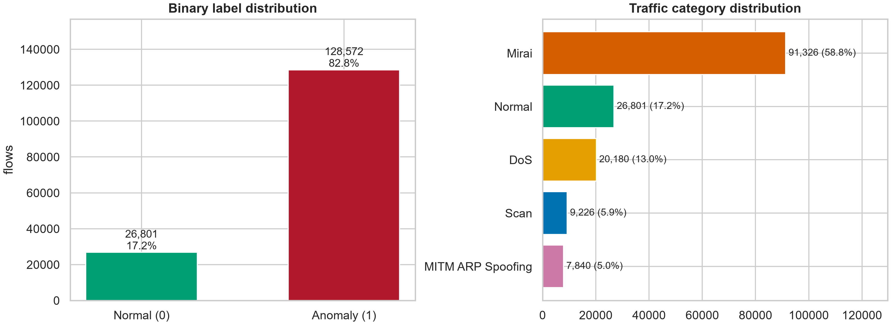
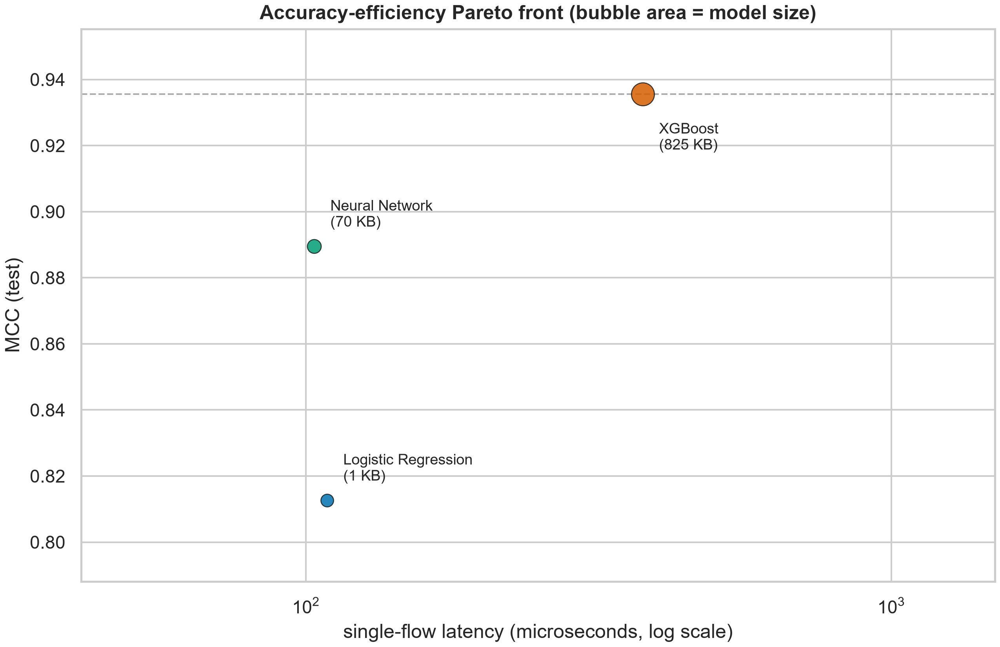
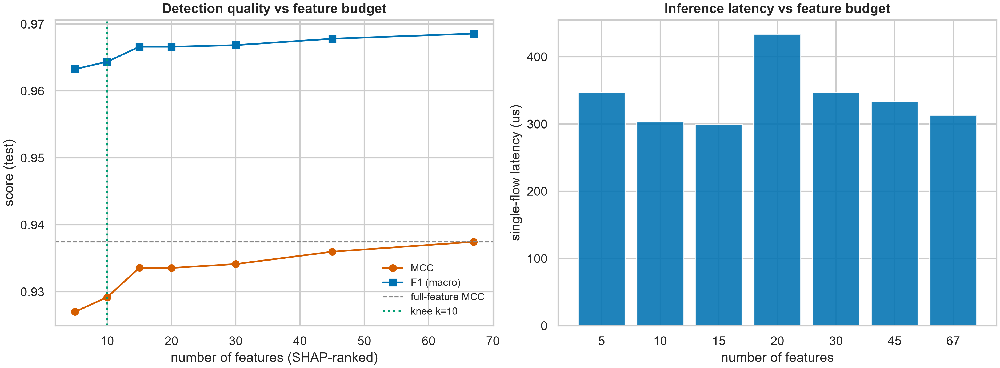
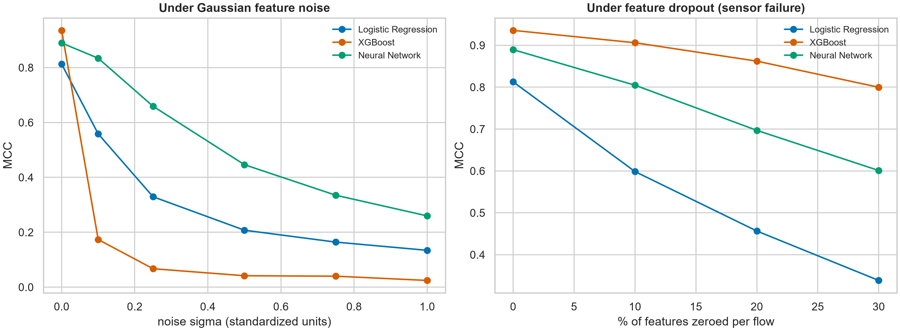
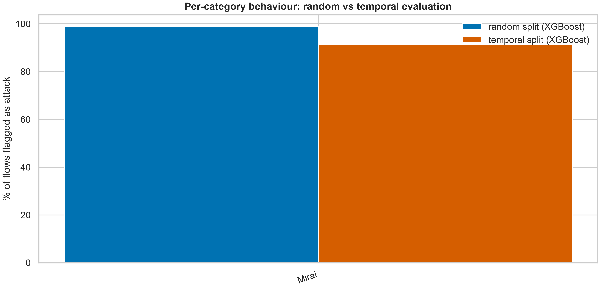
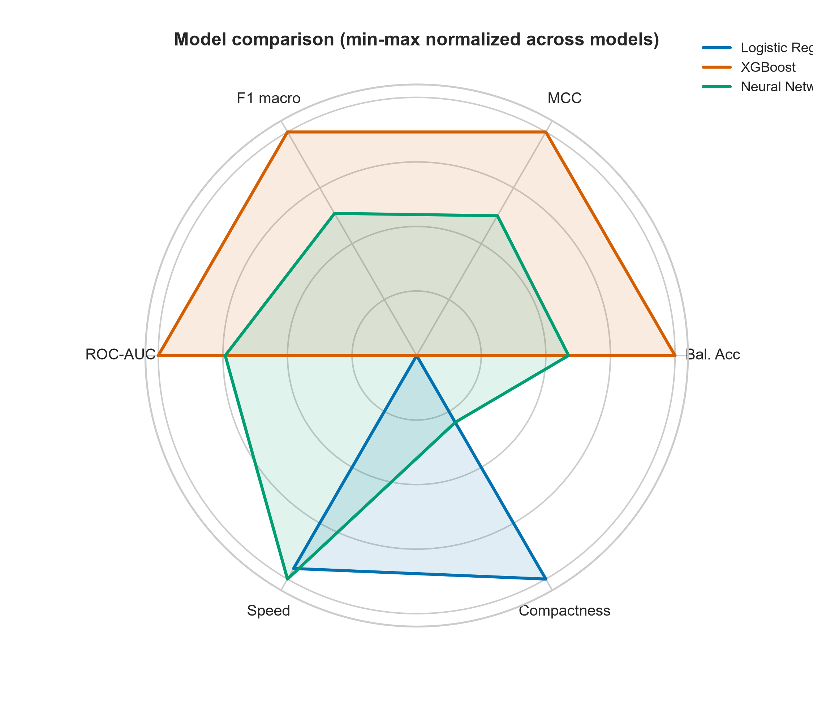

[English](README.md) | **فارسی**

<div dir="rtl">

# یادگیری ماشین سبک برای تشخیص نفوذ در شبکهٔ اینترنت اشیا

**مطالعه‌ای بر دقت · کارایی · مقاوم‌سازی روی دیتاست IoTID20**


[](https://colab.research.google.com/github/hannah8877h-dev/iotid20-ids-study/blob/main/IoTID20_Advanced_IDS_Study.ipynb)

دسته‌بندی دودویی و دومرحله‌ایِ جریان‌های شبکهٔ اینترنت اشیا با سه مدل **سبک**
(رگرسیون لجستیک، XGBoost و یک MLP کوچکِ PyTorch) — طراحی‌شده برای اجرای کامل روی یک
لپ‌تاپ معمولی (فقط CPU، حدود ۳۵ دقیقه)، و در عین حال پاسخ به سؤال‌هایی که در استقرار واقعی
اهمیت دارند: **این مدل چقدر دقیق است؟ چقدر سریع؟ چقدر کوچک؟ چقدر مقاوم؟ — و ارزیابی‌اش
چقدر صادقانه؟**

---

## چرا این «یک نوت‌بوک دیگر از جنس train/test» نیست

| # | تحلیل | چه چیزی را نشان می‌دهد |
|---|----------|----------------|
| ۱ | ممیزی کیفیت داده + اسکن افزونگی | ۷۵٪ جریان‌های تکراری، ستون‌های سنتینل، ۳۷ جفت ویژگی همبسته |
| ۲ | واقعیت‌سنجی مدل‌های بدوی | چرا دقتِ ۸۲.۸٪ روی داده‌ای با اکثریت حمله، **هیچ ارزشی** ندارد |
| ۳ | معیارهای آگاه از عدم‌توازن (MCC، دقت متوازن، PR-AUC، Brier) | ارزیابی‌ای که در کشفِ شدید کلاس‌ها دوام می‌آورد |
| ۴ | ROC + نمای دوگانهٔ Precision–Recall | پوشش حمله در برابر بار هشدار کاذب، دیده‌شده به‌صورت جداگانه |
| ۵ | بنچمارک کارایی | تأخیر تک‌جریان، توان‌عملیاتی دسته‌ای، حجم مدل |
| ۶ | **جبههٔ پارتو** دقت–کارایی | داستان کامل انتخاب مدل در یک نمودار |
| ۷ | تفسیرپذیری SHAP + پروفایل هر حمله | مدل به چه چیزی نگاه می‌کند — به تفکیک هر خانوادهٔ حمله |
| ۸ | **آزمایش بودجهٔ ویژگی** | ۱۰ ویژگی از ۶۷، MCC را در فاصلهٔ 0.01 از مجموعهٔ کامل نگه می‌دارد |
| ۹ | **نقاط عملیاتی هزینه‌محور** (C_FN ≫ C_FP) | ۸۸٪ کاهش هزینهٔ مورد انتظار هشدار نسبت به قاعدهٔ سادهٔ آستانهٔ 0.5 |
| ۱۰ | **خط لولهٔ دومرحله‌ای** (تشخیص ← دسته‌بندی نوع حمله) | از هشدار تا برچسب عملیاتی |
| ۱۱ | **تست استرس مقاوم‌سازی** (نویز + حذف ویژگی) | منحنی‌های افت نرم برای هر مدل |
| ۱۲ | **بررسی تعمیم زمانی** | تقسیم تصادفی روی ضبط‌های زمانیِ قطعه‌بندی‌شده چه چیزی را پنهان می‌کند |
| ۱۳ | مدل‌های ترکیبی + **کالبدشکافی نمونه‌های سخت** | همهٔ مدل‌ها کجا با هم شکست می‌خورند، و چرا |

## نتایج کلیدی

اجرای کامل، seed 42، مجموعهٔ تست = ۲۵٪ نگه‌داشته‌شده از **۱۵۵,۳۷۳ جریان یکتا** (۹۳.۶٪ حمله):

| مدل | MCC | دقت متوازن | PR-AUC | تأخیر هر جریان | توان‌عملیاتی | حجم مدل |
|---|---|---|---|---|---|---|
| Logistic Regression | 0.813 | 0.939 | 0.9959 | 109 µs | 10.6 M flows/s | **1.1 KB** |
| **XGBoost** | **0.936** | **0.976** | **0.9994** | 376 µs | 1.2 M flows/s | 825 KB |
| Neural Network (MLP) | 0.890 | 0.961 | 0.9986 | **103 µs** | 4.2 M flows/s | 70 KB |

**واقعیت‌سنجی مدل بدوی:** پیش‌بینیِ «همه‌چیز حمله است» روی این دیتاست **۸۲.۸٪ دقت** می‌دهد —
دقیقاً به همین دلیل، همهٔ نتیجه‌گیری‌های این مطالعه بر معیارهای آگاه از عدم‌توازن استوار است.

## داده واقعاً چه شکلی است

- **۷۵.۲٪ از IoTID20 جریان‌های تکراریِ دقیقاً یکسان‌اند** — از ۶۲۵,۷۸۳ سطر، ۴۷۰,۴۱۰ سطر
  تکراری حذف می‌شوند و ۱۵۵,۳۷۳ سطر یکتا باقی می‌ماند. تکراری‌ها *قبل از* تقسیم حذف می‌شوند؛
  وگرنه همان جریانی که هم در train هست و هم در test، همهٔ امتیازها را متورم می‌کند.
- ستون `Init_Fwd_Win_Byts` **۱۰۰٪ سنتینل** است (روی تک‌تک جریان‌ها `-1`)؛ ۹ ویژگی دیگر هم
  ثابت‌اند ← از ۷۷ ویژگی، **۶۷ ویژگیِ دارای اطلاعات** باقی می‌ماند.
- سنتینل‌های CICFlowMeter ترمیم شدند: **۸۶۱,۴۷۵ مورد `-1`** به‌علاوهٔ ۷۳۶ مورد `inf`؛
  مقادیر گم‌شده فقط با **میانهٔ مجموعهٔ train** پر شدند.
- ۳۷ جفت ویژگی همبستگی بالای 0.95 دارند — منحنی بودجهٔ ویژگی نشان می‌دهد می‌توان
  تشخیص‌دهنده‌ای با تنها **۱۰ ویژگی** در ۹۹٪ کیفیت ساخت (MCC برابر 0.929 در برابر 0.938).

## نگاه استقرار (deployment)

- MLP قهرمان سرعت است: **۱۰۳ میکروثانیه برای هر جریان (~۴.۲ میلیون جریان بر ثانیه در
  حالت دسته‌ای)** با تنها **۷۰ کیلوبایت** — قابل استقرار روی گیت‌وی.
- آستانه‌گذاری هزینه‌آگاه (C_FN:C_FP = 10:1) روی XGBoost **هزینهٔ مورد انتظار هشدار را
  ۸۸٪ کاهش می‌دهد** نسبت به آستانهٔ سادهٔ 0.5.
- زیر قاعدهٔ SOC یعنی *FPR ≤ ۱٪*، XGBoost هنوز **۹۱.۳٪** حمله‌ها را تشخیص می‌دهد (آستانهٔ 0.93).

## بررسی‌های مقاوم‌سازی و صداقت

- **نویز گاوسی** (σ = 1.0 در فضای استانداردشده): XGBoost فرو می‌ریزد (MCC از 0.94 به 0.02)
  در حالی که MLP نرم‌ترین افت را دارد (از 0.89 به 0.26) — تقسیم‌های درختی در برابر جابه‌جایی
  توزیع شکننده‌اند.
- **حذف تصادفی ویژگی‌ها** (شبیه‌سازی خرابی حسگر): XGBoost با صفرشدن ۳۰٪ ویژگی‌ها هنوز
  MCC = 0.80 دارد.
- **صداقت زمانی:** ضبط IoTID20 از نظر زمانی قطعه‌بندی شده — ۱۵٪ آخرِ ضبط **فقط جریان‌های
  Mirai** دارد، پس MCC آن‌جا تعریف‌نشده است (به `results/temporal_fold_composition.csv`
  نگاه کنید). مدلِ زمان‌نگه‌داشته هنوز **۹۱.۵٪** آن جریان‌ها را علامت زد؛ در برابر ۹۸.۹٪ در
  تقسیم تصادفی — یعنی تقسیم تصادفی خوش‌بینانه است.
- **دسته‌بندی دومرحله‌ای:** F1 برای DoS برابر 0.999، Mirai برابر 0.906، Scan برابر 0.619 و
  MITM ARP-spoofing برابر 0.516 — سردرگمی دقیقاً جایی متمرکز است که جریان‌ها خود را شبیه
  ترافیک سالم نشان می‌دهند.
- **نمونه‌های سخت** که هر سه مدل از دست دادند: Normal (۱۴۲)، Mirai (۱۱۴)، Scan (۱۱۱) —
  جریان‌های حمله‌ای که رفتاری شبیه ترافیک پس‌زمینه دارند.

## نمودارها (۱۹ عدد، 300 DPI، در پوشهٔ `figures/`)

| | | |
|---|---|---|
|  |  |  |
|  |  |  |

## ساختار ریپازیتوری

```
├── IoTID20_Advanced_IDS_Study.ipynb   # کل مطالعه، از ابتدا تا انتها
├── figures/                           # ۱۹ نمودار آمادهٔ انتشار (300 DPI)
├── results/                           # ۱۸ جدول CSV/TXT از جمله key_findings.txt
├── scripts/download_data.py           # دانلود ناشناس از Kaggle با kagglehub
├── requirements.txt
├── CITATION.cff                       # نحوهٔ ارجاع به این ریپو
├── LICENSE                            # MIT (کد)؛ وضعیت دیتاست: پایین را ببینید
└── .gitignore                         # data/ و models/ هرگز commit نمی‌شوند
```

## اجرای سریع

```bash
pip install -r requirements.txt
python scripts/download_data.py          # دریافت IoTID20 (~۵۳ مگابایت) در ./data
jupyter notebook IoTID20_Advanced_IDS_Study.ipynb
```

- اجرای کامل ≈ ۳۵ دقیقه روی لپ‌تاپ ۱۲هسته‌ای، فقط CPU. تست سریع: `FAST_MODE=1` (~۵ دقیقه).
- هر اجرا، پوشه‌های `figures/` و `results/` و `models/` را کنار نوت‌بوک از نو می‌سازد.
- ۸ گیگابایت رم کافی است (ویژگی‌ها به‌صورت `float32` بارگذاری می‌شوند).
- اگر Kaggle در شبکهٔ شما در دسترس نیست، کافی است فایل CSV دیتاست (یا `.csv.gz` یا
  زیپ‌های چندبخشی) را در `data/` بگذارید — نوت‌بوک خودش آن‌ها را پیدا و به هم می‌دوزد.

### اجرا در ابر — Google Colab (بدون نصب هیچ‌چیز)

نوت‌بوک در tier رایگان Colab هم به‌صورت کامل اجرا می‌شود (رانتایم CPU کافی است).

1. چهار فایل `IoTID20_part*k*of4.zip` (یا همان CSV تکی) را در پوشه‌ای در Google Drive
   بگذارید، مثلاً `MyDrive/iotid20/data`.
2. نوت‌بوک را با بج **Open In Colab** بالا باز کنید (مستقیماً همین نوت‌بوک را باز می‌کند)،
   یا در colab.research.google.com از تب *GitHub* آدرس ریپو را بدهید.
3. یک سلول **درست بعد از سلول تنظیمات SECTION 0** (قبل از سلولِ داده در Section 1 که
   تابع `find_dataset_parts` را تعریف و صدا می‌زند) اضافه کنید و اجرا کنید:

   ```python
   from google.colab import drive
   drive.mount('/content/drive')
   DATA_DIR = Path('/content/drive/MyDrive/iotid20/data')   # پوشهٔ زیپ‌ها
   ```

4. منوی `Runtime → Run all`. در پایان، خروجی‌ها را بسته‌بندی و دانلود کنید:

   ```python
   !zip -qr colab_outputs.zip figures results models
   from google.colab import files; files.download('colab_outputs.zip')
   ```

## دیتاست و مجوز

**IoTID20** — دیتاست نفوذ شبکهٔ اینترنت اشیا: ۶۲۵,۷۸۳ جریانِ برچسب‌خورده از دو دستگاه واقعی
خانهٔ هوشمند (دوربین EZVIZ و اسپیکر SKT NUGU)، ۴ خانوادهٔ حمله: Mirai، DoS، Scan و
MITM ARP Spoofing. Kaggle:
[`rohulaminlabid/iotid20-dataset`](https://www.kaggle.com/datasets/rohulaminlabid/iotid20-dataset).
استفادهٔ پژوهشی رایگان توسط نویسندگان دیتاست مجاز شمرده شده است؛ خود دیتاست در این
ریپو **بازنشر نمی‌شود**.

> Ullah, I. & Mahmoud, Q. H. (2020). *A Scheme for Generating a Dataset for Anomalous Activity
> Detection in IoT Networks.* Canadian AI 2020, LNCS 12109, Springer.
> https://doi.org/10.1007/978-3-030-47358-7_52

## بازتولیدپذیری

seed عدد `42` همه‌جا (numpy / random / PYTHONHASHSEED / XGBoost / torch).
فایل `results/environment.csv` مشخصات دقیق اجرای مرجع را ثبت کرده است: Python 3.12.10،
pandas 3.1.1، scikit-learn 1.9.1، xgboost 3.4.1، torch 2.15.0، Windows 11، ۱۲ هستهٔ منطقی.
نوت‌بوک با هر دو نسخهٔ pandas 2.x و 3.x تست شده (ایمن در برابر copy-on-write).

## نقشهٔ راه

- [x] نوت‌بوک بازتولیدپذیر با خروجی خودکار نمودار/جدول
- [ ] پیش‌نویس مقالهٔ کنفرانسی (نگاشت نمودار ← بخش، در انتهای نوت‌بوک)
- [ ] خروجی ONNX از مدلِ بودجهٔ ویژگی برای استقرار لبه (edge)

## ارجاع

به [`CITATION.cff`](CITATION.cff) مراجعه کنید. اگر این ریپو به پژوهش شما کمک کرد، لطفاً
مقالهٔ دیتاست IoTID20 را ارجاع دهید (و این مطالعه را هم وقتی preprint شد).

**نویسنده:** حنانه شبستانی (Hananeh Shabestani) — [@hannah8877h-dev](https://github.com/hannah8877h-dev)

</div>
