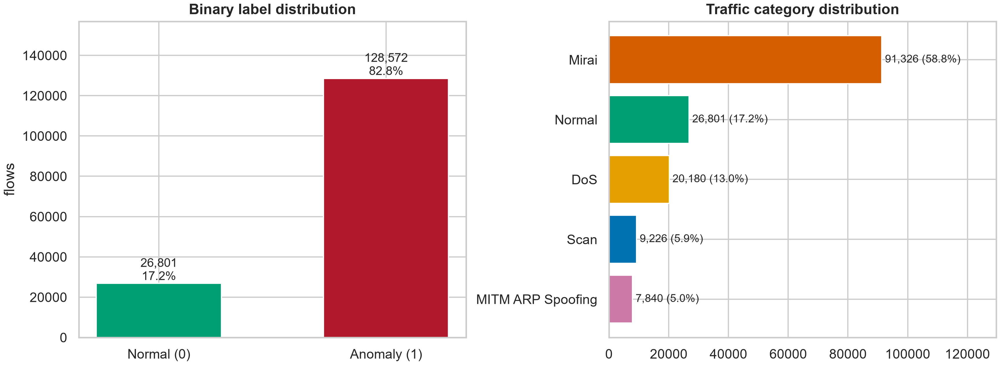
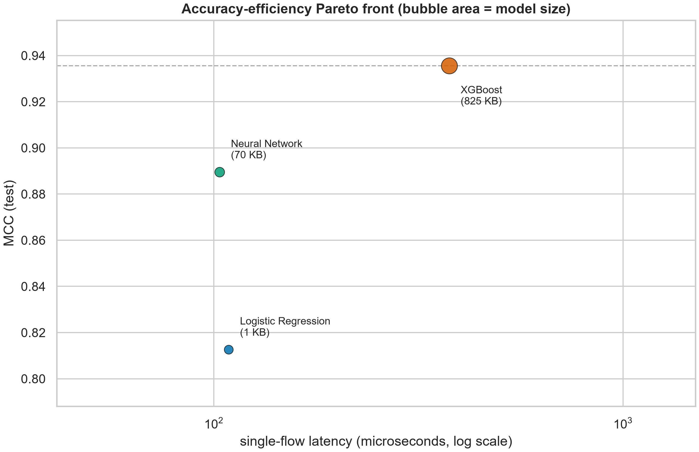
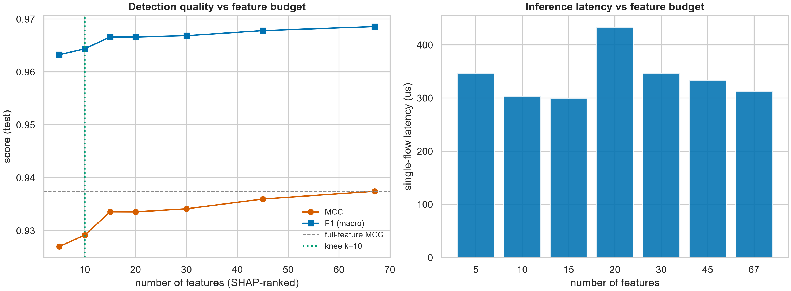
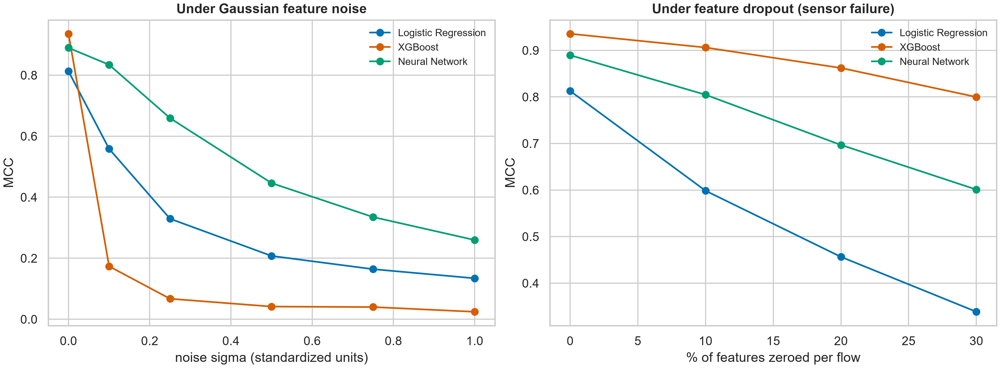
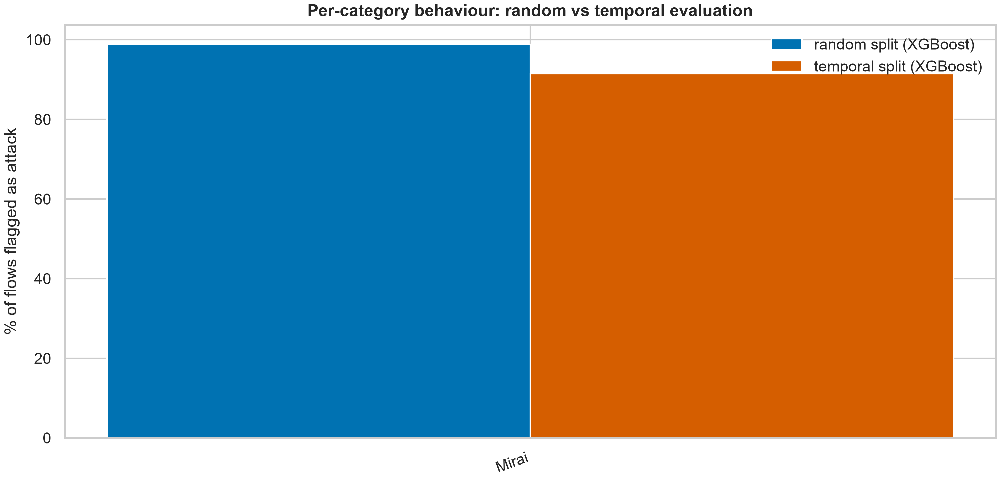
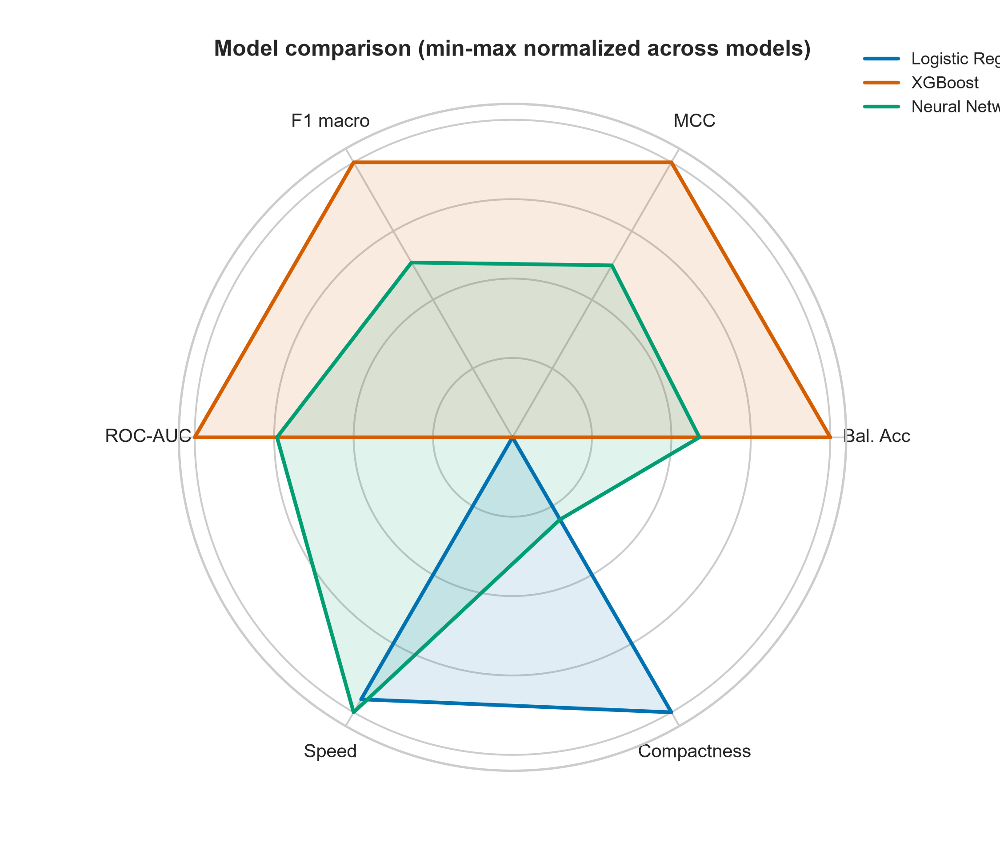

English | [فارسی](README.fa.md)

# Lightweight Machine Learning for IoT Intrusion Detection

**An Accuracy · Efficiency · Robustness Study on the IoTID20 Dataset**


[](https://colab.research.google.com/github/hannah8877h-dev/iotid20-ids-study/blob/main/IoTID20_Advanced_IDS_Study.ipynb)

Binary + two-stage classification of IoT network flows with three **lightweight** models
(Logistic Regression, XGBoost, a small PyTorch MLP) — designed to run end-to-end on a
normal laptop (CPU-only, ~35 min) while answering the questions a real deployment cares
about: **how accurate, how fast, how small, how robust — and how honest — is the evaluation?**

---

## Why this is not "another train/test notebook"

| # | Analysis | What it shows |
|---|----------|----------------|
| 1 | Data-quality audit + redundancy scan | 75% duplicate flows, sentinel columns, 37 correlated feature pairs |
| 2 | Trivial-baseline reality check | why 82.8% accuracy is worth **zero** on attack-majority data |
| 3 | Imbalance-aware metrics (MCC, Balanced Acc, PR-AUC, Brier) | evaluation that survives extreme class skew |
| 4 | ROC + dual-view Precision–Recall | attack coverage vs. false-alarm burden, seen separately |
| 5 | Efficiency benchmark | single-flow latency, batch throughput, model size |
| 6 | Accuracy–efficiency **Pareto front** | one-figure model-selection story |
| 7 | SHAP explainability + per-attack profiles | what the model looks at, per attack family |
| 8 | **Feature-budget experiment** | 10 of 67 features keep MCC within 0.01 of the full set |
| 9 | **Cost-sensitive operating points** (C_FN ≫ C_FP) | −88% expected alert cost vs. the 0.5 rule |
| 10 | **Two-stage pipeline** (detect → classify attack type) | from alarm to actionable label |
| 11 | **Robustness stress test** (noise + feature dropout) | graceful-degradation curves per model |
| 12 | **Temporal generalization check** | what random splits hide on chronologically-segmented captures |
| 13 | Ensembles + **hard-sample forensics** | where all models fail together, and why |

## Headline results

Full run, seed 42, test = 25% hold-out of **155,373 deduplicated flows** (93.6% attacks):

| Model | MCC | Balanced Acc | PR-AUC | Latency / flow | Throughput | Model size |
|---|---|---|---|---|---|---|
| Logistic Regression | 0.813 | 0.939 | 0.9959 | 109 µs | 10.6 M flows/s | **1.1 KB** |
| **XGBoost** | **0.936** | **0.976** | **0.9994** | 376 µs | 1.2 M flows/s | 825 KB |
| Neural Network (MLP) | 0.890 | 0.961 | 0.9986 | **103 µs** | 4.2 M flows/s | 70 KB |

**Trivial-baseline check:** predicting "everything is an attack" already yields **82.8% accuracy**
on this dataset — which is exactly why every conclusion here is drawn on imbalance-aware metrics.

## What the data actually looks like

- **75.2% of IoTID20 consists of exact duplicate flows** — 470,410 of 625,783 rows collapse into
  155,373 unique ones. Duplicates are removed *before* splitting, otherwise the same flow appearing
  in train and test inflates every score.
- `Init_Fwd_Win_Byts` is a **100% sentinel column** (`-1` on every single flow); 9 further features
  are constant → **67 informative features** remain out of 77.
- CICFlowMeter sentinels repaired: **861,475 × `-1`** + 736 × `inf`, imputed with **train-set medians only**.
- 37 feature pairs correlate above 0.95 — the feature-budget curve shows you can ship a detector
  with just **10 features** at 99% of the quality (MCC 0.929 vs 0.938).

## Deployment view

- The MLP is the speed champion: **103 µs/flow (~4.2 M flows/s batch)** at **70 KB** — gateway-deployable.
- Cost-aware thresholding (C_FN:C_FP = 10:1) on XGBoost **cuts the expected alert cost by 88%**
  compared to the naive 0.5 threshold.
- Under the SOC rule *FPR ≤ 1%*, XGBoost still detects **91.3%** of attacks (threshold 0.93).

## Robustness & honesty checks

- **Gaussian noise** (σ = 1.0 in standardized space): XGBoost collapses (MCC 0.94 → 0.02) while the
  MLP degrades most gracefully (0.89 → 0.26) — tree splits are brittle to distribution shift.
- **Feature dropout** (sensor failure): XGBoost keeps MCC 0.80 with 30% of features zeroed.
- **Temporal honesty:** IoTID20's capture is chronologically segregated — the last 15% of the
  capture contains **only Mirai flows**, so MCC is undefined there (see
  `results/temporal_fold_composition.csv`). The time-held-out model still flagged **91.5%** of
  those flows vs. 98.9% under a random split.
- **Two-stage classify:** DoS F1 = 0.999, Mirai 0.906, Scan 0.619, MITM ARP-spoofing 0.516 —
  confusion concentrates exactly where flows mimic benign traffic.
- **Hard samples** missed by *all three* models: Normal (142), Mirai (114), Scan (111) — the
  attack flows that behave like background traffic.

## Figures (19 total, 300 DPI, in `figures/`)

| | | |
|---|---|---|
|  |  |  |
|  |  |  |

## Repository layout

```
├── IoTID20_Advanced_IDS_Study.ipynb   # the whole study, top-to-bottom
├── figures/                           # 19 publication-ready PNGs (300 DPI)
├── results/                           # 18 CSV/TXT tables incl. key_findings.txt
├── scripts/download_data.py           # anonymous Kaggle download via kagglehub
├── requirements.txt
├── CITATION.cff                       # cite this repo
├── LICENSE                            # MIT (code); dataset: see below
└── .gitignore                         # data/ and models/ never get committed
```

## Quickstart

```bash
pip install -r requirements.txt
python scripts/download_data.py          # fetch IoTID20 (~53 MB) into ./data
jupyter notebook IoTID20_Advanced_IDS_Study.ipynb
```

- **Full run ≈ 35 min** on a 12-core laptop, CPU-only. Smoke test: set `FAST_MODE=1` (~5 min).
- Every run regenerates `figures/`, `results/` and `models/` next to the notebook.
- 8 GB RAM is enough (features are loaded as `float32`).
- If Kaggle is unreachable from your network, simply drop the dataset CSV (or its `.csv.gz` /
  split ZIP parts) into `data/` — the notebook detects and stitches them automatically.

### Run in the cloud — Google Colab (nothing to install)

The notebook runs end-to-end in the free Colab tier (CPU runtime is sufficient).

1. Put the four `IoTID20_part*k*of4.zip` files (or the single CSV) in a Google Drive
   folder, e.g. `MyDrive/iotid20/data`.
2. Open the notebook with the **Open In Colab** badge above (it opens this notebook
   directly), or via colab.research.google.com → *GitHub* tab → paste the repo URL.
3. Insert a cell **right after the SECTION 0 config cell** (before Section 1, which
   defines and calls `find_dataset_parts`) and run it:

   ```python
   from google.colab import drive
   drive.mount('/content/drive')
   DATA_DIR = Path('/content/drive/MyDrive/iotid20/data')   # folder holding the zips
   ```

4. `Runtime → Run all`. When finished, package and download the outputs:

   ```python
   !zip -qr colab_outputs.zip figures results models
   from google.colab import files; files.download('colab_outputs.zip')
   ```

## Dataset & license

**IoTID20** — IoT Network Intrusion Dataset: 625,783 labelled flows from two real smart-home
devices (EZVIZ camera, SKT NUGU speaker), 4 attack families: Mirai, DoS, Scan, MITM ARP Spoofing.
Kaggle: [`rohulaminlabid/iotid20-dataset`](https://www.kaggle.com/datasets/rohulaminlabid/iotid20-dataset).
Free use for academic research is granted by the authors; the dataset itself is **not** redistributed
in this repository.

> Ullah, I. & Mahmoud, Q. H. (2020). *A Scheme for Generating a Dataset for Anomalous Activity
> Detection in IoT Networks.* Canadian AI 2020, LNCS 12109, Springer.
> https://doi.org/10.1007/978-3-030-47358-7_52

## Reproducibility

Seed `42` everywhere (numpy / random / PYTHONHASHSEED / XGBoost / torch).
`results/environment.csv` records the exact reference run: Python 3.12.10, pandas 3.1.1,
scikit-learn 1.9.1, xgboost 3.4.1, torch 2.15.0, Windows 11, 12 logical cores.
The notebook is tested against both pandas 2.x and pandas 3.x (copy-on-write safe).

## Roadmap

- [x] Reproducible notebook with automated figure/table export
- [ ] Conference paper draft (figure → section mapping at the end of the notebook)
- [ ] ONNX export of the feature-budget model for edge deployment

## Citation

See [`CITATION.cff`](CITATION.cff). If this repository helps your research, please cite the
IoTID20 dataset paper above (and this study once its preprint is out).

## Author

**Hananeh Shabestani** — [@hannah8877h-dev](https://github.com/hannah8877h-dev)
